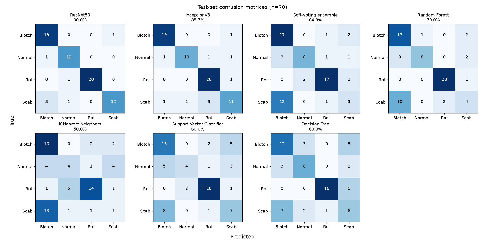
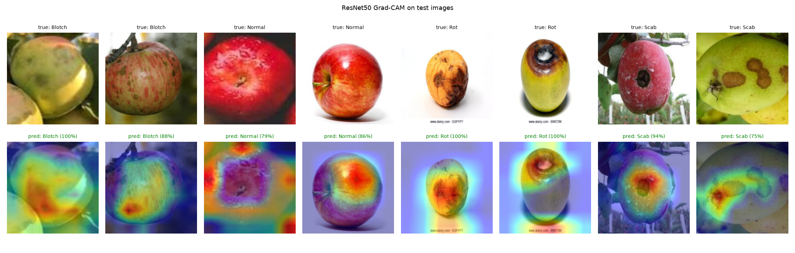

# Fruit Disease Detection and Pesticide Recommendation (Apple)

A web app that classifies an apple photo into one of four classes (**Blotch**, **Rot**, **Scab**, **Normal**)
and shows a matching treatment and pesticide recommendation. We compare five classical ML models
(on raw pixels) with two transfer-learning CNNs (ResNet50 and InceptionV3).

Final-year B.E. (Computer Engineering) project at Pimpri Chinchwad College of Engineering (SPPU), 2022–23.
Our literature review for this project, [*"A Review on Plant Disease Detection Techniques"*](https://ijsret.com/wp-content/uploads/2021/11/IJSRET_V7_issue6_791.pdf),
was published in IJSRET, Vol. 7, Issue 6 (Nov–Dec 2021). The paper describing this system and its original
2023 results is in [`docs/research_paper.pdf`](docs/research_paper.pdf), and the project report is in
[`docs/project_report_2023.pdf`](docs/project_report_2023.pdf).

> **Upgraded in 2026 to a stricter evaluation protocol.** I revisited the project with deduplicated data,
> a group aware train / validation / test split, preprocessing built into the model, and every model
> retrained and evaluated once on an untouched test set. Under this protocol ResNet50 reaches **90.0%**
> test accuracy and InceptionV3 **85.7%**. The protocol and test set differ from the 2023 paper, so the
> two sets of numbers are not directly comparable. See [2026 evaluation upgrade](#2026-evaluation-upgrade).

## Results (held-out test set, n = 70)

Every model was trained on the train split, tuned / early-stopped on the validation split, and evaluated
**once** on the test split. The 95% confidence intervals (Wilson) are wide because the test set is small.

| Model | 2023 reported | Val acc | **Test acc** (95% CI) | Test macro-F1 | F1 Blotch | F1 Normal | F1 Rot | F1 Scab |
|---|---|---|---|---|---|---|---|---|
| ResNet50 (transfer learning) | 80.0% | 87.1% | **90.0%** (81%–95%) | 0.894 | 0.88 | 0.89 | 0.98 | 0.83 |
| InceptionV3 (transfer learning) | 55.0% | 81.4% | **85.7%** (76%–92%) | 0.846 | 0.93 | 0.83 | 0.89 | 0.73 |
| Random Forest | 69.0% | 68.6% | **70.0%** (58%–79%) | 0.664 | 0.68 | 0.73 | 0.93 | 0.32 |
| Soft-voting ensemble (DT+RF+KNN+SVC) | 63.0% | 71.4% | **64.3%** (53%–74%) | 0.607 | 0.65 | 0.70 | 0.83 | 0.25 |
| Support Vector Classifier | 55.0% | 65.7% | **60.0%** (48%–71%) | 0.565 | 0.57 | 0.42 | 0.84 | 0.44 |
| Decision Tree | 53.0% | 65.7% | **60.0%** (48%–71%) | 0.595 | 0.57 | 0.62 | 0.84 | 0.35 |
| K-Nearest Neighbors | 59.0% | 64.3% | **50.0%** (39%–61%) | 0.435 | 0.59 | 0.35 | 0.72 | 0.08 |

**Ablation: the 2023 preprocessing setup (no `preprocess_input`), same new split**

| Model | Val acc | Test acc (95% CI) | Test macro-F1 |
|---|---|---|---|
| InceptionV3, raw 0–255 pixels (2023 bug) | 52.9% | 50.0% (39%–61%) | 0.472 |
| ResNet50, raw 0–255 pixels (2023 setup) | 81.4% | 88.6% (79%–94%) | 0.875 |

How to read these numbers:

- **InceptionV3 depends heavily on its own input scaling.** With the same split, head and training,
  using InceptionV3's `preprocess_input` raises test accuracy from 50.0% to 85.7%, because the network
  expects inputs in [-1, 1]. This explains its weak 2023 result.
- **ResNet50 is robust to input scaling** (88.6% vs 90.0%; the confidence intervals overlap almost
  entirely). The upgraded pipeline still builds preprocessing into the model so the app and training always match.
- **90% is not a like-for-like improvement over the 2023 figure of 80%.** The test set is different
  (deduplicated, 70 images instead of 120), the 2023 figure was measured on the same data used for
  model selection, and this run adds light augmentation and dropout. Given the confidence interval
  (81–95%), the honest summary is *"about 80–95% on a small, in-distribution test set"*.
- Across models, **Scab is the hardest class** (it is most often confused with Blotch) and **Rot is the
  easiest**. The classical models on raw pixels fail almost completely on Scab.

ResNet50 per-class test metrics:

| Class | Precision | Recall | F1 | Support |
|---|---|---|---|---|
| Blotch | 0.83 | 0.95 | 0.88 | 20 |
| Normal | 0.86 | 0.92 | 0.89 | 13 |
| Rot | 1.00 | 0.95 | 0.98 | 21 |
| Scab | 0.92 | 0.75 | 0.83 | 16 |



Grad-CAM shows which regions drive ResNet50's predictions. The model mostly attends to lesions, but in
some images it looks at the background or the image borders (see Limitations).



The raw numbers are in [`results/summary.csv`](results/summary.csv). Per-model JSON files (per-class metrics,
confusion matrix, chosen hyperparameters, best epoch) and confusion-matrix images are in
[`results/per_model/`](results/per_model/), and training curves are in [`results/history/`](results/history/).

## Data

The dataset (`data/apple_dataset.zip`) was assembled by our team from apple images collected from various
online sources and sorted by hand into the four classes. Many file names show they come from stock-photo
sites (e.g. iStock, Shutterstock, Alamy), so the images are **not** licensed for redistribution beyond
research and education.

| Class | Train | Val | Test | Total |
|---|---|---|---|---|
| Blotch_Apple | 93 | 20 | 20 | 133 |
| Normal_Apple | 59 | 13 | 13 | 85 |
| Rot_Apple | 100 | 21 | 21 | 142 |
| Scab_Apple | 78 | 16 | 16 | 110 |
| **Total** | **330** | **70** | **70** | **470** |

### How the split was made

[`src/make_split.py`](src/make_split.py) pools the original `Train/` and `Test/` folders (502 images), then:

1. **Removes exact duplicates** (same file bytes): 30 images. Some of them appeared in *both* the
   original Train and Test folders.
2. **Groups near-duplicates** with a perceptual hash (pHash, Hamming distance ≤ 4) so that resized or
   re-encoded copies always land in the same split.
3. **Excludes label conflicts.** One photo appears as both Blotch and Scab, so both copies are dropped
   (listed in [`data/splits/excluded.csv`](data/splits/excluded.csv)).
4. Makes a **stratified, group-aware 70/15/15 split** with a fixed seed (42).

The resulting file lists are committed in [`data/splits/`](data/splits/) (`train.csv`, `val.csv`, `test.csv`),
so the exact split can be reproduced without re-running the script.

## Method

- **CNNs:** ImageNet-pretrained ResNet50 / InceptionV3 backbone (frozen) with global average pooling,
  a Dense(512, ReLU) layer, Dropout(0.3) and a softmax output. Input is 180×180 RGB. Light augmentation
  (horizontal flip, ±10% rotation and zoom). Adam (lr 1e-3), batch size 32, up to 60 epochs with early
  stopping on validation loss (patience 10, best weights restored). Best epochs: ResNet50 7, InceptionV3 10.
- **Preprocessing lives inside the model** (a serializable `BackbonePreprocess` layer in
  [`src/models.py`](src/models.py)). A saved model takes raw 0–255 RGB pixels, so training and the app cannot
  drift apart.
- **Classical models:** flattened 180×180×3 pixels scaled to [0, 1]. Hyperparameters are chosen on the
  validation split by grid search, and the final models are fitted on the train split only. Chosen values:
  Decision Tree `max_depth=5`; Random Forest `n_estimators=300, max_depth=10, min_samples_leaf=2`;
  KNN `k=1`; SVC (RBF) `C=1`. The ensemble is a soft-voting combination of the four.
- **Metrics:** accuracy with a 95% Wilson interval, per-class precision/recall/F1, macro-F1 and confusion matrices.

## 2026 evaluation upgrade

| 2023 setup | Why it mattered | 2026 upgrade |
|---|---|---|
| InceptionV3 notebook was a copy of the ResNet one: `ImageDataGenerator(rescale=1/252)` (typo for 1/255) was defined but never used, and the model was saved as `resnet50withoutaug` | InceptionV3 got raw 0–255 pixels instead of [-1, 1]; 55% accuracy | Uses InceptionV3's own `preprocess_input`, inside the model |
| ResNet50 was trained on raw pixels, but `app.py` applied `resnet.preprocess_input` before predicting | The deployed model saw differently scaled inputs from those it was trained on | Preprocessing is inside the model; the app only resizes |
| The test set was also used as the validation set during training | Optimistically biased test accuracy | Separate validation split; test set used once |
| 30 exact-duplicate images, some in both Train and Test | Test leakage | Deduplication + near-duplicate grouping |
| Soft-voting ensemble used `SVC()` without `probability=True` | Every grid-search fit failed (all scores NaN), so the "best" hyperparameters were just the first grid entry | `probability=True`; each model tuned on validation |
| Hard-coded `C:\Users\Admin\...` and Google Drive paths; 286 MB of `.h5` models committed | Not reproducible; huge repository | Relative paths; models moved to GitHub release assets |

The original notebooks are kept in [`notebooks/original_2023/`](notebooks/original_2023/) for reference
(only their file paths were changed). The reproducible pipeline is in [`src/`](src/).

## Repository layout

```
app.py                  Flask web app
src/                    split, training, evaluation and Grad-CAM scripts
data/apple_dataset.zip  the dataset; data/splits/*.csv = the committed split
results/                metrics, confusion matrices, Grad-CAM, training curves
notebooks/original_2023 original 2023 notebooks (kept for reference)
docs/                   IJSRET paper and project report (2023)
examples/               sample images for the app (see examples/README.md)
templates/, static/     web front-end
```

## How to run

```bash
python3.12 -m venv .venv && source .venv/bin/activate
pip install -r requirements.txt
```

**Get the model.** Download `resnet50.keras` from this repository's
[Releases](../../releases) page into `models/`, or train it yourself (a few minutes on a laptop CPU):

```bash
python -m src.make_split                         # unzip data, write data/splits/*.csv (already committed)
python -m src.train_cnn --backbone resnet50      # -> models/resnet50.keras
```

**Run the web app** at http://127.0.0.1:5000:

```bash
python app.py
```

**Reproduce every result in this README:**

```bash
python -m src.train_cnn --backbone resnet50
python -m src.train_cnn --backbone inceptionv3
python -m src.train_cnn --backbone resnet50 --no-preprocess      # ablation
python -m src.train_cnn --backbone inceptionv3 --no-preprocess   # ablation
python -m src.train_classical
python -m src.evaluate_test      # the one-time test evaluation -> results/summary.*
python -m src.gradcam
```

Seeds are fixed, but results can still vary by a point or two across hardware and TensorFlow versions.
The numbers above were produced with the versions in `requirements.txt` on Python 3.12 (macOS, Apple silicon, CPU).

## Limitations

- **Small dataset:** 470 images, and only 70 in the test set. One image is worth 1.4 accuracy
  points, and the confidence intervals are ±7–10 points.
- **One fruit, four classes.** The system only knows apples and always outputs one of the four labels,
  even for a photo that is not an apple at all.
- **Web / stock images, not field images.** Many photos are studio shots with plain backgrounds, and some
  carry stock-site watermarks. In particular, many Rot images are on white backgrounds. Grad-CAM shows the
  model sometimes uses the background, so accuracy on real orchard photos is likely lower. Images were
  deduplicated, but test images come from the same sources as training images (no external test set).
- **Labels were not verified by a plant pathologist.** One label conflict was found and removed; others may exist.
- **Treatment advice is generic** text per class, not agronomic advice. Check local guidance before applying any pesticide.

## Team

Samvedya Jedhedeshmukh, Sahil Kachole, Nishant Parakh and Umesh Chaudhari, guided by Dr. Madhura Kalbhor,
Department of Computer Engineering, PCCOE, Pune.

**My role (Samvedya):** team lead. I proposed the project idea, built the machine-learning pipeline
(the classical models, the ensemble and the ResNet50 / InceptionV3 transfer-learning models), wrote the Flask
backend, and adapted the Bootstrap web template the team chose for the front-end. In 2026 I designed and ran
the evaluation upgrade described above.